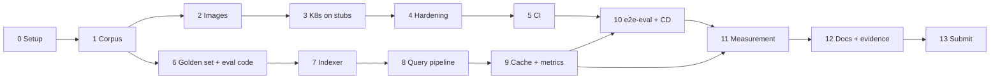

# RAHBAR: Phases

Assignment 02 (SE3005) · Team: **Wasay** and **Zain** · **Due Sunday 8 Nov 2026, 23:59 PKT**
(no late submissions, no retake).

This file is the at-a-glance view: what we build, in which order, who owns it, and how we
know a phase is done. The reasoning behind each decision is in
[`docs/DEVELOPMENT-PLAN.md`](docs/DEVELOPMENT-PLAN.md); the handout section for each item is
given in brackets, e.g. (§4.3).

**Status as of Tue 3 Nov (evening):** phases 0–5 are done, except ADR 0001 (Wasay, in his
own words) and requiring the CI checks in the ruleset. Next: phase 6 (golden set, Zain) and
phase 7 (indexer).

---

## Who does what

The proposed split is by layer, so we rarely edit the same files. Swap it if you prefer, but
keep one owner per phase.

| | Wasay: **platform** | Zain: **RAG** |
| --- | --- | --- |
| Owns | Docker, Kubernetes manifests, security, CI/CD, cluster evidence | Corpus, indexer, retrieval, generation, cache, evaluation |
| Main folders | `k8s/`, `.github/workflows/`, `*/Dockerfile`, `Makefile` | `indexer/pipeline/`, `api/app/`, `eval/` |
| Shared | `/readyz` and the embedding-pin check (needs both sides), README, engineering notes, ADRs | |

Both of us review the other's pull requests (`main` needs one approval), and both must be
able to explain every part in a viva.

## Phase overview

| # | Phase | Owner | When | Status |
| --- | --- | --- | --- | --- |
| 0 | [Repository and setup](#phase-0-repository-and-setup) | Wasay | Mon 2 | ✅ Done |
| 1 | [Corpus](#phase-1-corpus) | Wasay | Mon 2 – Tue 3 | ✅ Done (one follow-up) |
| 2 | [Container images](#phase-2-container-images) | Wasay | Tue 3 | ✅ Done |
| 3 | [Kubernetes around the stubs](#phase-3-kubernetes-around-the-stubs) | Wasay | Tue 3 – Wed 4 | ✅ Done (ADR 0001 left) |
| 4 | [Hardening: probes, pin, security, scaling](#phase-4-hardening-probes-pin-security-scaling) | Wasay | Tue 3 | ✅ Done |
| 5 | [CI pipeline](#phase-5-ci-pipeline-ciyml) | Wasay | Tue 3 | ✅ Done (ruleset step left) |
| 6 | [Golden set and evaluation code](#phase-6-golden-set-and-evaluation-code) | Zain | Tue 3 – Wed 4 | ✅ Done |
| 7 | [Indexing pipeline](#phase-7-indexing-pipeline) | Zain (+ Wasay for the corpus volume) | Wed 4 – Sat 7 | ✅ Done: real index on minikube |
| 8 | [Query pipeline and generation](#phase-8-query-pipeline-and-generation) | Zain | Thu 5 – Sat 7 | ✅ Done: real answers on minikube |
| 9 | [Semantic cache and metrics](#phase-9-semantic-cache-and-metrics) | Zain (+ Wasay for Redis) | Fri 6 | ✅ Code complete |
| 10 | [End-to-end eval in CI, and CD](#phase-10-end-to-end-eval-in-ci-and-cd) | Wasay | Thu 5 – Sat 7 | ⏳ CD written and tested locally; e2e-eval waits on phases 6–7 |
| 11 | [Measurement and failure analysis](#phase-11-measurement-and-failure-analysis) | Both | Sat 7 | ⬜ |
| 12 | [Documentation and evidence](#phase-12-documentation-and-evidence) | Both | Rolling, finish Sun 8 | ⬜ |
| 13 | [Submission](#phase-13-submission) | Both | Sun 8, by 20:00 | ⬜ |

The handout's rhythm: **Mon–Wed** run the whole system on Kubernetes with the stub retriever
and stub LLM; **Thu–Sun** replace the stubs with the real pipeline. Phases 3–5 (Wasay) and
6–7 (Zain) run in parallel.

---

## How we work (read once)

- **Branches.** Commit on `dev`, or on a short-lived branch merged into `dev`. Never push to
  `main`: it only changes through a pull request from `dev`, with CI green and the other
  person's approval (−4 marks for direct pushes). Open a `dev` → `main` PR **at least once a
  day** so CD runs early.
- **Before you push:** `git pull --rebase origin dev`, then `make test lint`.
- **Commits:** small and frequent, with conventional prefixes (`feat:`, `fix:`, `docs:`,
  `test:`, `build:`, `ci:`, `chore:`). The checker wants **≥ 25 commits**, ≥ 60 %
  conventional, and **each of us ≥ 35 % of the commits**, under our own Git identities.
- **Secrets:** never in a file. The LLM key is created with `make secret`. A key in Git
  history costs −20 even if deleted later.
- **AI use:** add a row to [`docs/AI-USAGE.md`](docs/AI-USAGE.md) whenever an AI tool writes
  or shapes something, and fill in what we changed afterwards.
- **Do not type the starter kit's TODO marker** in any file: the checker counts it everywhere
  (see "The checker" in `STARTER.md`).
- **The checker:** `make check` (or `python scripts/check_submission.py`). Run it at the end
  of each phase.

### Zain: getting set up

1. Accept the GitHub collaborator invite, then `git clone` and `git switch dev`.
2. On Windows, work inside **WSL 2 (Ubuntu)** with Docker Desktop's WSL integration on; the
   Makefile needs bash. Install Python 3.12.
3. `make install && make test && make lint` (11 tests should pass), then `make dev` and open
   http://localhost:8000.
4. `make fetch` downloads the corpus into `corpus/raw/` (gitignored), then
   `python corpus/fetch.py --verify` checks the checksums.
5. Install [Ollama](https://ollama.com), run it with `OLLAMA_HOST=0.0.0.0`, then
   `ollama pull llama3.2:3b` and `ollama pull nomic-embed-text`.

---

## Phase 0: Repository and setup

**Owner:** Wasay · **Status:** ✅ Done (Mon 2 Nov)

- [x] Repository on GitHub, `main` + `dev` branches
- [x] `main` protected by a ruleset: PR required, 1 approval, no force push or deletion, no
      bypass. *Status checks get added in phase 5, once `ci.yml` has run once.*
- [x] Starter kit committed; `.gitignore` merged; `.gitattributes` keeps LF line endings
- [x] 11 starter tests, ruff and mypy pass
- [x] Development plan committed
- [ ] Zain added as a collaborator with Write access

## Phase 1: Corpus

**Owner:** Wasay · **Status:** ✅ Done, merged in PR #1 · (§2)

- [x] 9 FAST-NUCES documents, 279 PDF pages + 2 HTML pages, listed in `corpus/sources.yaml`
- [x] `corpus/MANIFEST.md` with URL + SHA-256 for each (the PDFs are never committed)
- [x] All 7 required properties mapped in [`docs/CORPUS.md`](docs/CORPUS.md), with
      `pdffonts` evidence for the scanned PDF
- [x] Version pair: Aug 2023 rules (superseded, image-only, OCR tested and works) vs Jun 2026
      handbook. **Four rules genuinely changed** (failed courses, extra courses, position
      medals, FYP credits); attendance 1.21 and CGPA 5.4 did *not* change
- [x] Absent topic: **hostel rules**. Transport is *not* absent (annual reports cover it)
- [ ] Follow-up for phase 7: a before-and-after OCR sample in `docs/PIPELINE.md`

## Phase 2: Container images

**Owner:** Wasay · **Status:** ✅ Done (Tue 3 Nov)

- [x] `api/Dockerfile`, `ui/Dockerfile`, `indexer/Dockerfile` with pinned bases, non-root
      user, exec-form command, `.dockerignore` files
- [x] Indexer builds from the repo root: `docker build -f indexer/Dockerfile .` (`make images`
      does this). It contains tesseract, poppler, `corpus/fetch.py` and the CI fixtures
- [x] All three run with a read-only root filesystem and all capabilities dropped
- [x] Trivy (HIGH/CRITICAL, fixed only): **0 findings** on all three, after upgrading
      starlette, pypdf and pdfminer.six
- Note for phase 3: `chromadb/chroma:1.0.12` runs as **root** by default

## Phase 3: Kubernetes around the stubs

**Owner:** Wasay · **When:** Tue 3 – Wed 4 · (§4.1, §4.2)

Goal: the whole system runs on minikube with `RETRIEVER=stub`, `LLM_PROVIDER=stub` and the
dummy index, and answers through the Ingress.

- [x] `make cluster` (minikube 1.39 / Kubernetes 1.37 with **Calico**, metrics-server, ingress)
- [x] `k8s/base/`: namespace `rahbar`, ConfigMap, one ServiceAccount per workload
- [x] Chroma **StatefulSet** with `volumeClaimTemplates` (not a Deployment), ClusterIP Service
- [x] Redis Deployment + PVC (`appendonly yes`), ClusterIP Service
- [x] api Deployment (3 replicas, stubs), ui Deployment (2 replicas), their Services
- [x] Ingress: `/` → ui, `/api` → api, host `rahbar.local`
- [x] indexer **Job** (`restartPolicy: OnFailure`, `backoffLimit: 4`) running `--dummy`, with
      an initContainer that waits for Chroma's heartbeat
- [x] **CronJob** `reindex`, weekly (Sun 03:00 PKT), same image and arguments as the Job
- [x] `k8s/overlays/dev` (local `:dev` images) and `k8s/overlays/prod` (Docker Hub images,
      tag set by CD; placeholders until phase 10)
- [x] `secret.placeholder.yaml` with `REPLACE_ME`, **not** listed in `kustomization.yaml`
- [ ] ADR [`docs/adr/0001-indexer-as-job.md`](docs/adr/) **in our own words** (the marker reads
      it first). Wasay writes this one; the reasoning is in §4.2 and in the plan, D1

**Done when:** `make images apply`, then `make ask Q="..."` returns the stub answer through the
Ingress, and the dummy index survives deleting the Chroma pod. ✅ Verified 3 Nov: stub answer
through the Ingress with the request id in the api's logs; 3 dummy chunks still there after
`kubectl delete pod chroma-0`.

**Two things that broke on the way** (material for Engineering Note 7):
1. `chroma-0` crash-looped with `expected u16 for key "PORT"`. Kubernetes injects
   `CHROMA_PORT=tcp://<ip>:8000` into every pod because a Service is named `chroma`, and
   Chroma 1.x reads every `CHROMA_*` variable as its own config. Fix: `enableServiceLinks: false`
   on every pod.
2. After that fix, the StatefulSet still did not replace the crashing pod: a rolling update
   waits for the current pod to become Ready, which a crash-looping pod never does. Fix:
   `kubectl delete pod chroma-0` by hand. Meanwhile the indexer Job had burned its
   `backoffLimit` against the dead Chroma, hence the wait-for-chroma initContainer.

On Windows with the docker driver, reach the Ingress with `minikube tunnel` (needs an admin
terminal) or `kubectl -n ingress-nginx port-forward svc/ingress-nginx-controller 18088:80`
and the header `Host: rahbar.local`.

At stake: −8 Chroma/Redis without a PVC or exposed outside the cluster; −10 indexing at API
startup; −5 anything in the `default` namespace.

## Phase 4: Hardening: probes, pin, security, scaling

**Owner:** Wasay · **When:** Tue 3 · (§4.3–§4.7) · **Status:** ✅ Done (3 Nov)

The checker's Kubernetes section passes completely. Phase 7 must keep `/readyz` and the pin
check working when the indexer switches to the blue/green collection pointer (plan, D1).

- [x] api probes exactly as §4.3: startup and liveness on `/healthz`, readiness on `/readyz`
- [x] **`/readyz`** (`api/app/services/readiness.py`): 200 only if Chroma answers, the
      collection exists and is non-empty, its `embed_model` matches, and Redis answers;
      otherwise 503 with `failed` naming the first failure and every check listed. Chroma is
      called over REST with a 2 s timeout, because `chromadb.HttpClient` connects in its
      constructor and has no timeout. Logs only when readiness changes. 9 unit tests
- [x] **Embedding-pin guardrail**: checked at startup (in a background thread, so liveness
      is not delayed) and on every readiness probe; on mismatch the pod stays not-ready and
      logs both model names. Demo done: `docs/evidence/embedding-pin-guardrail.txt`
- [x] Requests and limits on **every** container, including the Job and its initContainer
      (initial values; phase 11 sets them from `kubectl top`)
- [x] HPA on api: `autoscaling/v2`, min 3, max 8, CPU 70 %; reads `3%/70%`. Right after pods
      are replaced it shows `<unknown>` for about a minute until metrics-server has samples
- [x] Rolling update `maxSurge: 1`, `maxUnavailable: 0`, `terminationGracePeriodSeconds: 45`,
      `preStop` sleep 10 s
- [x] Security context on every pod: `runAsNonRoot`, `readOnlyRootFilesystem`, drop `ALL`
      capabilities, seccomp `RuntimeDefault`, `automountServiceAccountToken: false`; Chroma
      runs as 1000 and Redis as 999, with `fsGroup` on their volumes
- [x] NetworkPolicy (`k8s/base/networkpolicy.yaml`): deny by default, allow DNS, then only
      ui←ingress, api←ingress/ui, chroma←api/indexer, redis←api. The dev overlay adds
      api/indexer → Ollama on the laptop (`192.168.65.254` with Docker Desktop). Tested:
      **the ui times out reaching chroma and redis; the api reaches chroma**
- [x] Evidence in `docs/evidence/`: rollout to `rahbar-ui:v2` and `rollout undo` verified
      through the Ingress; `kubectl get endpoints` with 3 IPs; `kubectl get hpa`; the pin
      demo; the NetworkPolicy test; deleting an api pod during 150 requests (**150 × 200**)

**Done when:** all pods Ready under the policies, the pin demo shows `0/1 READY` with the log
line, and the evidence files are in `docs/evidence/`. ✅

Still for phase 7: the indexer's egress to `nu.edu.pk` for the corpus fetch.

At stake: −8 embedding model able to disagree silently; −6 a container without requests or an
HPA reading `<unknown>`.

## Phase 5: CI pipeline (`ci.yml`)

**Owner:** Wasay · **When:** Tue 3 · (§6) · **Status:** ✅ Done, except the ruleset step

[`.github/workflows/ci.yml`](.github/workflows/ci.yml) runs on pull requests to `main` and
pushes to `dev`. First run green:
[run #1](https://github.com/includeduck/Rahbar-SCD/actions/runs/41693995772), about 1.5 min.

- [x] `lint`: ruff + mypy (api and indexer)
- [x] `test`: pytest with **≥ 60 % coverage** on the api package (`pytest-cov`; 86 % on the
      first run), plus the indexer tests; stubs only
- [x] `manifests`: every overlay rendered with `kubectl kustomize` and checked with
      `kubeconform -strict` (28 + 27 resources valid)
- [x] `build`: all three images, **no push**
- [x] `scan`: Trivy 0.58.1, HIGH/CRITICAL with a fix available → fail (0 findings)
- [x] `permissions: contents: read`; actions pinned (`checkout@v5`, `setup-python@v6`);
      the other tools are pinned by version, not by action
- [ ] **Wasay:** in the `main` ruleset, require `lint`, `test`, `manifests`, `build`, `scan`
      (`e2e-eval` once phase 10 adds it), then screenshot it for `docs/evidence/`

**Done when:** CI is green on `dev` and the ruleset requires the checks.

## Phase 6: Golden set and evaluation code

**Owner:** Zain · **When:** Tue 3 – Wed 4 · (§5.1–§5.4) · **Status:** ✅ Done

Write the golden set **before tuning anything**: a set written from what the retriever
already returns gives a flattering number that means nothing.

- [x] `eval/golden.yaml` with **≥ 15 questions** (aim for 18): 8 ordinary, 2 version,
      2 exact-term, 2 must-abstain, 1 injection. Draft questions are in the plan, §8.1
  - Version questions must use the rules that **changed** (failed courses 5.8, extra
    courses 4.3, medals 7.11, FYP credits 3.14), not attendance or CGPA
  - Must-abstain questions ask about **hostel rules** (application, fees, conduct), never
    about which campuses have hostels (that is answerable)
- [x] In `eval/run_eval.py`: `recall_at_k`, `citation_validity`, `summarise`, `gate`
- [x] Unit tests for all four functions
- [x] Section-matching rule decided and written in `docs/PIPELINE.md` (golden `"5.4"` matches
      `"5.4 Academic Warning"`, not `"5.41"`)

**Done when:** `make eval-fixtures` against `make dev` produces `results.json` and an exit code.

## Phase 7: Indexing pipeline

**Owner:** Zain · **When:** Wed 4 – Thu 5 · (§3.1, §4.4) · **Status:** ✅ Done. First real run 7 Nov: 710 chunks in 8 min 20 s, `docs/evidence/real-pipeline-first-run.txt`

Files: `indexer/pipeline/{extract,clean,chunk,embed,store}.py`.

- [x] **Extract:** PDF text per page with pdfplumber; tables kept row by row; pages with no
      text layer → OCR (pdf2image + pytesseract, `ocr=True`); HTML pages; Markdown fixtures
- [x] **Clean:** strip headers/footers that repeat on most pages and page numbers; keep
      headings and clause numbers
- [x] **Chunk:** structure-aware (sections → paragraphs → sentences) with overlap; every
      chunk carries `source, section, page, doc_version, superseded`; stable ids
- [x] **Embed:** Ollama `/api/embed` with `EMBED_MODEL`, batched
- [x] **Store:** write a new collection, then switch a pointer to it, so re-indexing never
      empties the index (plan, D1); record `embed_model` and `dimension` in its metadata
- [x] Job's initContainer fetches the corpus into a PVC (`fetch-corpus`, `corpus-data`), verified against `MANIFEST.md`
- [x] Unit tests for clean, chunk and store

**Done when:** the indexer Job builds the real index on minikube, and the pin demo flips from
`dummy-768` to the real model.

## Phase 8: Query pipeline and generation

**Owner:** Zain · **When:** Thu 5 – Fri 6 · (§3.2, §3.4, §3.5) · **Status:** ✅ Code complete

Files: `api/app/retrieval/chroma.py`, `api/app/providers/llm/{ollama,hosted,prompt}.py`,
`api/app/services/answer.py`, `api/app/routes/ask.py`.

- [x] `ChromaRetriever.retrieve`: same embedding model, top-k from the ConfigMap,
      `superseded` filter unless the question asks about an older version
- [x] Relevance floor: below it, **abstain without calling the LLM**
- [x] Prompt: instructions, then numbered and delimited evidence, then the question
- [x] `OllamaProvider` (and `HostedProvider`): Answer JSON schema as `format=`, low
      temperature, timeout
- [x] Validate with Pydantic, retry once, then a safe fallback (never a 500)
- [x] Drop any citation that does not match a retrieved chunk
- [x] Switch the ConfigMap to `RETRIEVER=chroma` and a real `LLM_PROVIDER` (base; the smoke overlay keeps stubs for CD)
- [x] Tests: abstention, fallback on bad JSON, citation filter, **prompt injection with a
      poisoned chunk**, superseded filter
- [x] Pointer resolution: `readiness.py` and `ChromaRetriever` resolve `rahbar-active` pointer

**Done when:** through the Ingress, an ordinary question gets a cited answer, a hostel-rules
question gets `answered_from_context: false`, and the injection question is not obeyed.

At stake: −10 a citation that does not match a retrieved chunk; −10 a must-abstain question
answered.

## Phase 9: Semantic cache and metrics

**Owner:** Zain (Wasay wires Redis) · **When:** Fri 6 · (§3.3, §4.8) · **Status:** ✅ Code complete

Files: `api/app/services/cache.py`, `api/app/routes/metrics.py`, `api/app/routes/ask.py`.

- [x] Redis cache: hit when cosine ≥ the threshold from the ConfigMap
- [x] Never cache follow-ups, abstentions, fallbacks or failed validations
- [x] Invalidate on re-index (keys carry the index generation, plan D2)
- [ ] Threshold chosen from data: 2–3 values tried, the false hit that ruled one out
      (not yet measured: `CACHE_THRESHOLD` 0.95 is a placeholder; done in phase 11 with
      paraphrase pairs, the script and its output committed)
- [x] `X-Cache: hit|miss` header (the UI shows it)
- [x] Metrics: retrieval and generation latency, cache hits, abstentions, fallbacks, tokens
      in and out; one log line per request with chunk ids and scores
- [ ] ADR 0003 (why Redis), ADR 0004 (LLM provider and data governance)

## Phase 10: End-to-end eval in CI, and CD

**Owner:** Wasay · **When:** Thu 5 – Sat 7 · (§5.4, §6)

- [ ] `e2e-eval` job: kind cluster, apply the CI overlay, run the indexer Job on the fixture
      corpus, wait for rollout, run `eval/run_eval.py`, enforce the gate
  - Embeddings in CI: in-cluster Ollama with only `nomic-embed-text`, `LLM_PROVIDER=stub`
- [x] [`cd.yml`](.github/workflows/cd.yml) on push to `main` (and by hand): `test` →
      `build-push` (needs `test`; Trivy on the exact images, then push to Docker Hub tagged
      with the commit SHA only) → `deploy` (needs `build-push`; runs
      [`scripts/cd/deploy-kind.sh`](scripts/cd/deploy-kind.sh): kind cluster, ingress-nginx,
      prod overlay pinned to the SHA, indexer Job, `rollout status` on everything, smoke test
      through the Ingress). The first run on `main` (after PR #3) published the images but
      `deploy` failed: the runner already has a root-owned `kind` in `/usr/local/bin`. Fixed by
      installing into `$RUNNER_TEMP/bin`; a manual run on `dev` then passed all three jobs:
      [run 42073476348](https://github.com/includeduck/Rahbar-SCD/actions/runs/42073476348)
- [x] Repository variable `DOCKERHUB_USERNAME` (`mwasaytariq`) and secret `DOCKERHUB_TOKEN`;
      the three Docker Hub repositories are public
- [x] **Green on `main`** after PR #4: [run 42075316258](https://github.com/includeduck/Rahbar-SCD/actions/runs/42075316258)
      (test → build-push → deploy, smoke test passed), images
      `mwasaytariq/rahbar-{api,ui,indexer}:abaab10…` on
      [Docker Hub](https://hub.docker.com/u/mwasaytariq). These are submission items 2 and 3;
      the final submission should link the last green `main` run before the deadline
- [ ] Put both links in the README (phase 12)

The deploy script also runs locally (Git Bash): `bash scripts/cd/deploy-kind.sh <prefix>
<tag>` with kind and kustomize on the PATH. With Docker Desktop's containerd image store,
`kind load docker-image` fails on pulled multi-platform images, so the script falls back to
`docker save --platform` and `kind load image-archive`.
- [ ] Gate demo: a PR that drops recall shows a red check and a greyed-out merge button,
      then green after the fix (screenshots)

At stake: −6 a publishing job without `needs:` or deploying `:latest`.

## Phase 11: Measurement and failure analysis

**Owner:** both · **When:** Sat 7 · (§3.1, §4.5, §5.5)

- [ ] **Chunking:** at least 3 (size, overlap) settings, recall@5 for each, table in
      `docs/PIPELINE.md`, ADR 0002 for the one we ship (no measurement = zero on that line)
- [ ] Relevance floor and cache threshold chosen from golden-set scores
- [x] Commit `eval/baseline.json` and `eval/results.json` (real corpus): first live run 7 Nov,
      recall@5 0.625, citation validity 1.00, abstention 1.00 (`docs/PIPELINE.md` §7)
- [x] recall@3 and recall@5 by question type, and why exact-term recall is lower (§7: clause
      numbers carry little meaning for embeddings; "clause 1.21" by number is missed)
- [ ] Resource requests and limits set from **`kubectl top pods`** output (committed)
- [ ] `docs/FAILURE-ANALYSIS.md`: break 4 stages one at a time (planned: A no OCR,
      B fixed 100-token chunks, C pin mismatch or `top_k: 1`, E no superseded filter)

## Phase 12: Documentation and evidence

**Owner:** both, written as we go · **Finish:** Sun 8 · (§7, §10)

- [ ] `README.md`: problem, CI badge, Mermaid architecture, **exact apply order**, clean clone
      → answered question, API endpoint table, screenshot (−5 if the apply order fails)
- [ ] `docs/ARCHITECTURE.md` (why Chroma is a StatefulSet)
- [ ] `docs/PIPELINE.md`, `docs/FAILURE-ANALYSIS.md`, final `docs/CORPUS.md`
- [ ] `docs/ENGINEERING-NOTES.md`: all 7 questions **with our file paths and line numbers**
      (generic answers score zero). Note the "failure that cost us an hour" when it happens
- [ ] ADRs 0001–0004
- [ ] `docs/AI-USAGE.md` complete, including what we changed
- [ ] `docs/evidence/` (≥ 5 files): ruleset, blocked merge, `kubectl top`,
      `kubectl get endpoints`, `kubectl get hpa`, plus rollout/undo, pin demo, NetworkPolicy
      test, pod deletion, re-index without redeploy

## Phase 13: Submission

**Owner:** both · **Target:** Sun 8 Nov, **20:00 PKT** (4 hours of buffer)

- [ ] Fresh clone on a deleted cluster: follow the README word for word
- [ ] `make check` clean
- [ ] Final `dev` → `main` PR merged; CD run green
- [ ] Google Classroom, one entry per team:
  1. GitHub repository URL (public, or private with both instructors added)
  2. Link to a successful `cd.yml` run
  3. Link to the Docker Hub images showing SHA tags
  4. `eval/results.json` and `eval/baseline.json` committed

---

## Deduction checklist (§8)

| Deduction | Rule | Phase |
| --- | --- | --- |
| −20 | Any secret in Git history | all |
| −15 | A real base64 value in a committed Secret | 3 |
| −10 | Indexing at API startup | 3, 7 |
| −10 | A citation not matching a retrieved chunk | 8 |
| −10 | A must-abstain question answered | 8, 11 |
| −8 | Chroma/Redis without a PVC, or exposed as NodePort/LoadBalancer | 3 |
| −8 | Embedding model not pinned, or able to disagree silently | 4, 7 |
| −6 | A container without requests, or HPA showing `<unknown>` | 4 |
| −6 | Publish/deploy job without `needs:`, or deploying `:latest` | 10 |
| −5 | Anything in the `default` namespace | 3 |
| −5 | README apply order fails from a clean clone | 12, 13 |
| −4 | Commits pushed directly to `main` | all |
