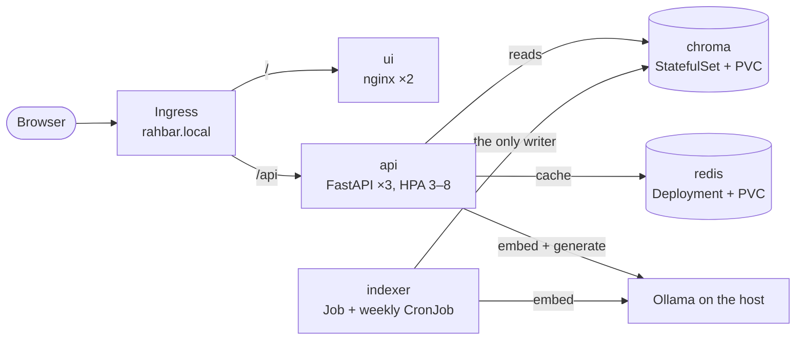

# RAHBAR

[](https://github.com/includeduck/Rahbar-SCD/actions/workflows/ci.yml)
[](https://github.com/includeduck/Rahbar-SCD/actions/workflows/cd.yml)

**A grounded question-answering service over FAST-NUCES academic documents, on Kubernetes.**

A student who wants to know whether they can take a course after failing its prerequisite
finds the answer in a numbered clause of a PDF, next to an older version of the same rules
that is also still online. A general-purpose chatbot will answer confidently from some other
university's rules. RAHBAR answers only from the university's own documents: it retrieves
the relevant passages from a vector index built ahead of time, generates a schema-checked
answer with a citation for every claim, prefers the current version of a policy over a
superseded one, and says so when the documents do not cover the question.

SE3005 Software Construction and Development, Assignment 02 · Muhammad Wasay Tariq and
Muhammad Zain Bin Jabir.

> **Status, 7 November 2026.** The platform is complete and verified: every Kubernetes
> object, the probes and embedding-model guardrail, NetworkPolicies, HPA, CI and CD. The
> indexing pipeline and the golden set are merged; the query pipeline (real retriever,
> Ollama generation, abstention, semantic cache) is in review. Until it merges, the
> deployed configuration uses the starter kit's stub retriever and model, and the indexer
> Job writes three dummy chunks. Progress: [`PHASES.md`](PHASES.md).

## Architecture



Indexing runs once, and again when the documents change; querying runs on every question.
So the indexer is a Job that writes the index and exits, and the api only ever reads it
([ADR 0001](docs/adr/0001-indexer-as-job.md)). Full design, including why Chroma is a
StatefulSet: [`docs/ARCHITECTURE.md`](docs/ARCHITECTURE.md).

## Repository map

```
api/         FastAPI service: reads the index, never writes it
indexer/     the Job's image: extract → clean → chunk → embed → store
ui/          static chat page served by nginx
corpus/      fetch.py, sources.yaml, MANIFEST.md (the documents themselves are not committed)
eval/        golden.yaml, run_eval.py, fixtures/ (small corpus for CI)
k8s/         base/ and overlays/{dev,prod}/ (Kustomize)
scripts/     check_submission.py, cd/deploy-kind.sh
docs/        CORPUS, PIPELINE, ARCHITECTURE, ADRs, evidence/, AI-USAGE
.github/     workflows/ci.yml, workflows/cd.yml
```

## Prerequisites

- Docker, [minikube](https://minikube.sigs.k8s.io/), `kubectl`
- `make` and bash (Linux, macOS, or WSL 2 on Windows), Python 3.12
- [Ollama](https://ollama.com) on the host, for embeddings and generation

On Windows, run `make` inside WSL 2, or type the commands each target prints. If your
distribution's `python3` is newer than 3.12, install 3.12 (for example with
`uv python install 3.12`) and run `make install PY="$(uv python find 3.12)"`.

## Without a cluster

```bash
make install      # .venv with the api, indexer and dev dependencies
make test         # unit tests: stubs only, no cluster, no model, no network
make lint         # ruff and mypy
make dev          # the api with stubs on http://localhost:8000, serving the chat UI too
```

## From a clean clone to an answered question

Run these in order from the repository root.

**1. Start minikube** with Calico (the default network plugin accepts NetworkPolicies and
then ignores them), metrics-server for the HPA, and the ingress addon:

```bash
make cluster
```

which runs `minikube start --driver=docker --cni=calico --memory=6144 --cpus=4`, then
`minikube addons enable metrics-server` and `minikube addons enable ingress`.

**2. Start Ollama on the host**, listening on all interfaces so the cluster can reach it at
`host.minikube.internal:11434`, and pull the two models:

```bash
OLLAMA_HOST=0.0.0.0 ollama serve
```
```bash
ollama pull llama3.2:3b
ollama pull nomic-embed-text
```

We embed through the same Ollama host we generate through: `nomic-embed-text` (768
dimensions) for both the indexer and the api, pinned in one ConfigMap key.

**3. Build the three images and load them into minikube** (minikube cannot see images in
your own Docker):

```bash
make images
```

**4. Create the namespace, and the Secret only if you use a hosted model:**

```bash
kubectl apply -f k8s/base/namespace.yaml
```
```bash
export LLM_API_KEY=...   # hosted mode only; skip for Ollama
make secret
```

**5. Apply everything:**

```bash
kubectl apply -k k8s/overlays/dev
```

**6. Wait for the indexer Job, then for the api.** The api reports ready only once the
collection exists, is not empty and matches `EMBED_MODEL`:

```bash
kubectl -n rahbar wait --for=condition=complete job/indexer --timeout=15m
kubectl -n rahbar rollout status deploy/api --timeout=5m
```

**7. Reach the Ingress and ask.** On Linux the Ingress is at `$(minikube ip)`. On macOS or
Windows with the docker driver, run `minikube tunnel` in another terminal (an administrator
terminal on Windows) and use `127.0.0.1`:

```bash
make ask Q="What CGPA puts a student on academic warning?"
make ask INGRESS_IP=127.0.0.1 Q="What CGPA puts a student on academic warning?"
```

To use the chat page in a browser, add `<ingress ip> rahbar.local` to your hosts file and
open `http://rahbar.local`.

**8. Ask about something the documents do not cover.** Hostel rules are left out on
purpose; with the real pipeline the answer comes back with `"answered_from_context": false`
(the starter kit's stub, still deployed today, answers everything):

```bash
make ask Q="How do I apply for a hostel room?"
```

**9. Delete an api pod and keep asking.** Nothing breaks: the other two keep serving, the
Service only sends traffic to ready pods, and the Deployment replaces the deleted one.

```bash
kubectl -n rahbar delete "$(kubectl -n rahbar get pods -l app.kubernetes.io/name=api -o name | head -1)"
```

## Re-indexing

No redeploy and no downtime: the indexer builds a new collection, then switches a pointer to
it. Run it on demand from the CronJob's template:

```bash
kubectl create job --from=cronjob/reindex manual-reindex-1 -n rahbar
```

(`make index` does the same with a timestamped name.) The `reindex` CronJob also runs weekly,
Sunday 03:00 PKT.

## API

| Method | Path | Purpose |
| --- | --- | --- |
| POST | `/api/ask` | `{"question": "..."}` (3 to 500 characters) → answer, citations, `answered_from_context`, `confidence`, the retrieved passages. Echoes `X-Request-ID`; `X-Cache: hit\|miss` |
| GET | `/healthz` | Liveness: the process is alive. Touches no dependency |
| GET | `/readyz` | Readiness: Chroma reachable, collection non-empty, embedding model matches, Redis reachable; otherwise 503 naming the failure |
| GET | `/metrics` | Prometheus metrics: request count and latency by route; retrieval and generation latency, cache hits, abstentions, fallbacks and tokens arrive with the query pipeline |
| GET | `/docs` | Interactive API documentation (FastAPI) |

## Configuration

Both programs read environment variables only, from the `rahbar-config` ConfigMap
(`k8s/base/configmap.yaml`) and the `rahbar-secret` Secret, so one image runs everywhere.

| Key | Used by | Meaning |
| --- | --- | --- |
| `EMBED_MODEL` | api, indexer | The embedding pin. The api refuses to become ready if the index was built with another model |
| `RETRIEVER`, `LLM_PROVIDER`, `LLM_MODEL` | api | `stub` or `chroma`; `stub`, `ollama-host` or `hosted`; the generation model |
| `TOP_K`, `RELEVANCE_FLOOR`, `CACHE_THRESHOLD`, `TEMPERATURE` | api | Retrieval depth, abstention floor, cache hit threshold, generation temperature |
| `CHUNK_SIZE`, `CHUNK_OVERLAP`, `CORPUS_DIR` | indexer | Chunking (words) and where the documents are |
| `CHROMA_HOST`, `REDIS_URL`, `OLLAMA_URL` | api, indexer | Service addresses |
| `LLM_API_KEY` | api | Secret only, hosted mode only |

## Corpus

Nine public documents from the FAST-NUCES website (279 PDF pages plus the Fee Structure and
Grading pages), including two versions of the academic rules (Aug 2023, superseded, and Jun
2026), a scanned policy that needs OCR, fee and grade tables, and long definitions. Hostel
rules are deliberately absent. Details: [`docs/CORPUS.md`](docs/CORPUS.md).

**The documents are not committed**, because they are not ours. We commit
[`corpus/MANIFEST.md`](corpus/MANIFEST.md) (each URL and its SHA-256),
[`corpus/sources.yaml`](corpus/sources.yaml) and the fetch script:

```bash
make fetch                        # downloads into corpus/raw/ (gitignored), one file at a time
python corpus/fetch.py --verify   # re-hashes every file against MANIFEST.md
```

## Evaluation

[`eval/golden.yaml`](eval/golden.yaml) holds 18 questions: ordinary, version-sensitive,
exact-term, must-abstain and prompt injection. [`eval/run_eval.py`](eval/run_eval.py)
asks a running stack each one and reports recall@3, recall@5 (overall and by question type),
citation validity and abstention correctness:

```bash
make eval
```

It exits non-zero when recall@5 falls more than 5 points below `eval/baseline.json`, when
any must-abstain question is answered, or when citation validity drops below 95 %.

## CI/CD

| Workflow | Runs on | Jobs |
| --- | --- | --- |
| [`ci.yml`](.github/workflows/ci.yml) | pull requests to `main`, pushes to `dev` | `lint` (ruff, mypy), `test` (pytest, coverage ≥ 60 %), `manifests` (kubeconform `-strict`), `build` (no push), `scan` (Trivy) |
| [`cd.yml`](.github/workflows/cd.yml) | pushes to `main` | `test` → `build-push` (Docker Hub, tagged with the commit SHA) → `deploy` (kind, rollout status, smoke test through the Ingress) |

- A green CD run on `main`: [run 42171972687](https://github.com/includeduck/Rahbar-SCD/actions/runs/42171972687)
- Images, tagged by commit SHA, never `:latest`: [hub.docker.com/u/mwasaytariq](https://hub.docker.com/u/mwasaytariq)

`main` is protected: pull request, passing checks and one approval required, no bypass.
Work happens on `dev`.

## Documentation

| Document | Contents |
| --- | --- |
| [`docs/ARCHITECTURE.md`](docs/ARCHITECTURE.md) | Objects, the two paths, probes, network, security, delivery |
| [`docs/CORPUS.md`](docs/CORPUS.md) | The nine documents and the seven required properties |
| [`docs/PIPELINE.md`](docs/PIPELINE.md) | The indexing stages and chunking measurements |
| [`docs/adr/`](docs/adr) | Architecture decision records |
| [`docs/evidence/`](docs/evidence) | Command output behind every claim: NetworkPolicy, embedding pin, rollout and undo, endpoints, HPA, pod deletion |
| [`docs/AI-USAGE.md`](docs/AI-USAGE.md) | Which AI tools wrote or shaped what, and what we changed |
| [`PHASES.md`](PHASES.md) | The plan, phase by phase, with what is done |
