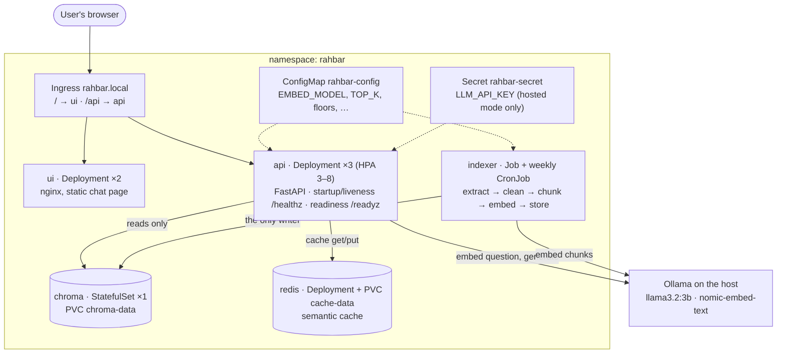
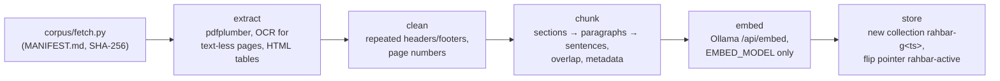
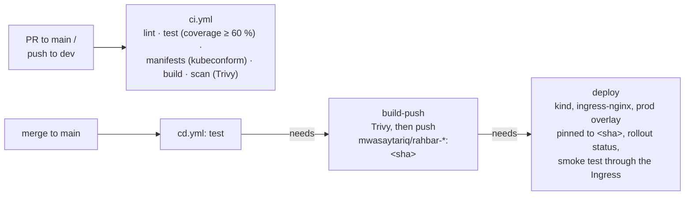

# Architecture

RAHBAR is a grounded question-answering service over FAST-NUCES documents. It has two paths
that never share a process: an **indexer** that writes the vector store when the documents
change, and an **api** that only reads it, on every question
([ADR 0001](adr/0001-indexer-as-job.md)).

## Kubernetes objects

Everything runs in the `rahbar` namespace. Manifests: [`k8s/base/`](../k8s/base), with
[`k8s/overlays/dev`](../k8s/overlays/dev) (minikube, local images) and
[`k8s/overlays/prod`](../k8s/overlays/prod) (Docker Hub images pinned to a commit SHA by CD).

| Object | Kind | Why it looks like this |
| --- | --- | --- |
| `api` | Deployment, 3 replicas, HPA 3–8 on CPU | Stateless reader. `maxSurge: 1`, `maxUnavailable: 0` and a 10 s preStop sleep, so a rollout never drops requests |
| `ui` | Deployment, 2 replicas | nginx on 8080 as uid 101; the browser calls `/api` on the same host, so nginx does not proxy |
| `chroma` | **StatefulSet**, 1 replica, `volumeClaimTemplates` | See [below](#why-chroma-is-a-statefulset) |
| `redis` | Deployment + PVC, `strategy: Recreate` | The cache survives a pod restart (`appendonly yes`); `Recreate` because the volume is ReadWriteOnce |
| `indexer` | Job (`restartPolicy: OnFailure`, `backoffLimit: 4`) | Runs once and exits; waits for Chroma's heartbeat in an initContainer |
| `reindex` | CronJob, Sunday 03:00 PKT, `concurrencyPolicy: Forbid` | Same image and arguments as the Job; also the template for manual re-indexing |
| Services ×4 | ClusterIP | Nothing is NodePort or LoadBalancer; users only come in through the Ingress |
| `rahbar-config` | ConfigMap | One place for every setting, read by both the api and the indexer |
| `rahbar-secret` | Secret | Created with `make secret`, never from a file. Only a `REPLACE_ME` placeholder is committed, and it is not in `kustomization.yaml` |
| NetworkPolicies | Deny by default | [Network](#network) |

## Why Chroma is a StatefulSet

The vector store is the one component whose data is the point. A StatefulSet gives it three
things a Deployment does not:

1. **Its own volume, created from `volumeClaimTemplates`.** `chroma-0` always gets
   `chroma-data-chroma-0`. Delete the pod and the new `chroma-0` reattaches the same volume
   with the same index: we checked this (3 chunks before and after
   `kubectl delete pod chroma-0`, `docs/evidence/`).
2. **A stable identity.** The pod is always `chroma-0`, so "which pod owns this index" never
   changes.
3. **One pod at a time.** A StatefulSet replaces `chroma-0` only after the old one has gone.
   A Deployment's rolling update starts the new pod *first*, so two Chroma processes would
   briefly share one ReadWriteOnce volume (or the new one would hang waiting for it).

One side effect we hit: a StatefulSet does not replace a pod that is crash-looping during a
rolling update, because the update waits for that pod to become Ready. A broken `chroma-0`
has to be deleted by hand after the fix is applied.

## The two paths

### Indexing: once, and again when the documents change

Every chunk carries `source`, `section`, `page`, `doc_version` and `superseded`. The
collection records `embed_model` and `dimension` in its metadata. Details and measurements:
[`PIPELINE.md`](PIPELINE.md).

### Querying: every question

1. Validate the question (3 to 500 characters, otherwise 422).
2. Check the semantic cache (skipped for follow-up questions).
3. Embed the question with the **same** model the indexer used.
4. Retrieve the top-k chunks from the collection the pointer names, excluding superseded
   documents unless the question asks about an older version.
5. If nothing clears the relevance floor, **abstain without calling the model**.
6. Build the prompt: instructions, then numbered and delimited evidence, then the question.
7. Generate a schema-constrained `Answer` at low temperature; validate it, retry once, then
   fall back to a safe non-answer (never a 500).
8. Drop any citation that does not match a retrieved chunk; cache the response only if it is
   safe to cache.

## Health, readiness and the embedding pin

| Endpoint | Probe | Checks |
| --- | --- | --- |
| `/healthz` | startup (30 × 2 s) and liveness (every 20 s) | Only that the process answers. It touches nothing else, so a slow dependency cannot trigger a restart storm |
| `/readyz` | readiness (every 10 s) | Chroma answers, the active collection exists and is not empty, its `embed_model` equals the api's `EMBED_MODEL`, and Redis answers. Otherwise 503 naming the failure; the pod leaves the Service but is not restarted |

`EMBED_MODEL` lives in one ConfigMap key read by both workloads. On top of that, the api
compares it with the model recorded in the collection: on a mismatch the pod stays at
`0/1 READY` and logs both names, instead of silently retrieving nonsense
(`docs/evidence/embedding-pin-guardrail.txt`).

## Network

Calico enforces the policies (minikube is started with `--cni=calico`). Everything is denied
by default, then:

| To | Allowed from | Port |
| --- | --- | --- |
| any pod | DNS egress to kube-dns | 53 UDP/TCP |
| ui | the ingress-nginx namespace | 8080 |
| api | the ingress-nginx namespace, ui | 8000 |
| chroma | api, indexer | 8000 |
| redis | api | 6379 |
| Ollama on the host (dev overlay) | api, indexer | 11434 |

The ui cannot reach Chroma or Redis
(`docs/evidence/networkpolicy-ui-cannot-reach-chroma.txt`).

## Security

- Every container runs as a fixed non-root uid with a read-only root filesystem, all
  capabilities dropped and the `RuntimeDefault` seccomp profile; anything that needs scratch
  space gets an `emptyDir` at `/tmp`.
- One ServiceAccount per workload, with `automountServiceAccountToken: false`: no pod talks
  to the Kubernetes API.
- `enableServiceLinks: false` on every pod. Kubernetes would otherwise inject
  `CHROMA_PORT=tcp://…` into every pod, and Chroma 1.x reads all `CHROMA_*` variables as its
  own configuration and refuses to start.
- Retrieved text and model output are untrusted: the output is schema-constrained and
  validated, never passed to `eval`, never used to build a query.

## Delivery

`main` is protected: a pull request, passing checks and one approval are required, and
nobody can bypass them. Images are tagged with the commit SHA only, never `:latest`.
